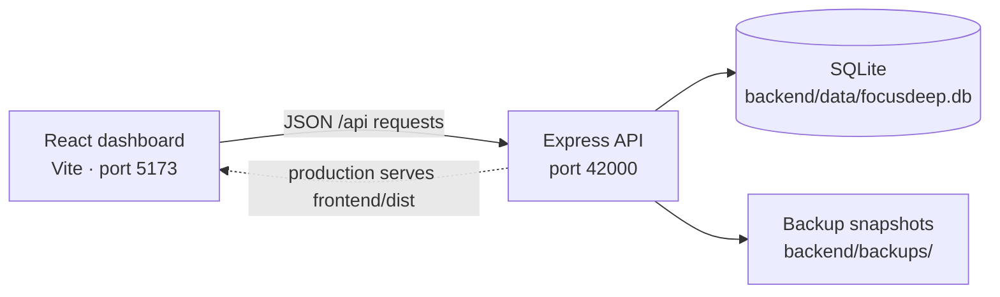

# FocusDeep

**A local-first focus tracker for turning time into visible progress.**

FocusDeep helps you record focused work, organize sessions into categories and groups, set goals, and understand where your time goes. It combines a React dashboard with an Express API and a persistent SQLite database—no account or hosted database required.

## What it does

- **Track focus sessions** with a persistent timer, quick category switching, and manual entry for work you have already completed.
- **Organize your work** into color-coded categories and groups, each with its own goal.
- **See your progress** in a dashboard with goal progress, daily averages, recent activity, and category/group breakdowns.
- **Explore your habits** with trend and distribution charts, including a custom category comparison.
- **Manage your history** by editing or deleting sessions, with undo for accidental deletions.
- **Keep your data recoverable** with SQLite persistence and automatic, manual, and pre-change backups.

## Screens and data flow



## Tech stack

| Layer | Technologies |
| --- | --- |
| Frontend | React 19, Vite, Tailwind CSS 4 |
| Interaction and visualization | Framer Motion, Recharts |
| API | Node.js, Express |
| Persistence | SQLite via better-sqlite3 |

## Run locally

**Requirements:** Node.js 20.19+ (or 22.12+) and npm.

```bash
# Install the root scripts and both app workspaces
npm install
npm run install:all

# Start the API and Vite development server
npm run dev
```

Open **http://localhost:5173**. During development, Vite proxies `/api` requests to the Express server on port `42000`. The API health check is available at **http://localhost:42000/api/health**.

### Production build

```bash
npm run lint
npm run build
npm start
```

The production server serves the compiled frontend from `frontend/dist` and the API from the same origin. Build the frontend before starting the production server.

## Data and backups

The SQLite database and generated snapshots live under `backend/data/` and `backend/backups/`. These are local runtime files and are intentionally excluded from Git. Backups are created on startup and shutdown, every 48 hours while the server is running, and before destructive data operations. Up to 30 snapshots are retained.

Create a backup manually:

```bash
npm run backup
```

Import a previously exported JSON data file:

```bash
npm run import --prefix backend -- /path/to/focusdeep-export.json
```

Import replaces the current database contents after first creating a pre-import backup. Keep your own copy of any data you want to preserve.

## Project layout

```text
backend/
  src/
    db/          SQLite schema and connection lifecycle
    routes/      HTTP endpoints
    services/    Domain operations and backup management
  scripts/       Backup and JSON import commands
frontend/
  src/
    api/         Backend client
    db/          Client-side data hook
    utils/       Statistics and formatting helpers
```

## Useful commands

| Command | Purpose |
| --- | --- |
| `npm run dev` | Run frontend and backend in watch/development mode |
| `npm run dev:frontend` | Run only the Vite frontend |
| `npm run dev:backend` | Run only the API |
| `npm run lint` | Check frontend code with ESLint |
| `npm run build` | Create the production frontend build |
| `npm start` | Serve the production build and API |
| `npm run backup` | Create a manual database snapshot |

---

Built as a full-stack project demonstrating React UI composition, API design, persistent data modeling, analytics, and recovery workflows.
